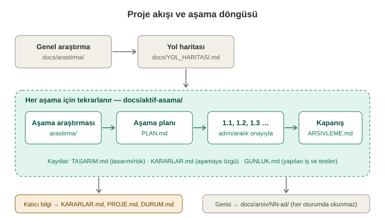

# AI proje şablonu (Codex + Claude + Gemini)

Codex, Claude Code, Gemini CLI, Gemini Code Assist ve Google Antigravity ile aynı çalışma düzenini kullanmak için kurulan küçük bir kural ve belge paketi.

Ortak kurallar proje kökündeki `AGENTS.md` dosyasındadır. Codex ve Google Antigravity bu dosyayı doğrudan okur ([Antigravity kural dosyaları](https://antigravity.google/docs/rules)); kurucu Claude için `CLAUDE.md`, Gemini CLI ve Gemini Code Assist için `GEMINI.md` (`@AGENTS.md`) giriş dosyalarını üretir.

Hedefler:
- **Bağlamı küçük tutma:** her oturumda kısa kurallar, durum notu ve planın yalnız başlangıç bölümü ile ilgili adımları okunur; ayrıntılı rehberler yalnız ilgili işte okunur.
- **Düzenli ilerleme:** genel plan → aşama planı → alt adım; ajan yalnız senin yetkilendirdiğin adımı veya adım aralığını uygular.
- **Unutmama:** kayıtlar iş sırasında (adım bitince, karar değişince, iş durunca) repo dosyalarına yazılır; sohbet veya araç değişse de son kayıt noktasından devam edilir.
- **Eski aşamaları okumama:** biten aşama arşive taşınır, kalıcı bilgisi ana belgelere aktarılır.



## Kurulum

Şablon paketinin kökünde Windows PowerShell ile:

```powershell
powershell.exe -NoProfile -File .\kur.ps1 -TargetDirectory "C:\Projeler\ProjeAdi"
```

Betik çalıştırma engellenirse yalnız bu işlem için:

```powershell
powershell.exe -NoProfile -ExecutionPolicy Bypass -File .\kur.ps1 -TargetDirectory "C:\Projeler\ProjeAdi"
```

Kurucu yalnız yeni dosya ekler. Kurulacak dosyalardan biri hedefte varsa hiçbir şey yazmadan durur. Ağ veya Git işlemi yapmaz; `.claude`, `.codex`, `.gemini` ve diğer global klasörlere dokunmaz. Projendeki diğer dosyalar olduğu gibi kalır.

Windows'ta araçlar Markdown dosyalarını CRLF satır sonuyla kaydedebilir; o zaman Git bütün dosyayı değişmiş gösterir ve küçük kayıt değişiklikleri büyük fark gibi görünür. Projenin `.gitattributes` dosyasına `*.md text eol=lf` satırını eklemen önerilir. Kurucu ve güncelleyici bu dosyaya yazmaz; satırı sen eklersin.

Ajana repo bağlantısını verip kurdurmak istersen şunu söyleyebilirsin:

> Bu şablon reposunu geçici bir klasöre indir, kur.ps1 ile şu anki projeme kur, kurulum sonucunu göster ve geçici klasörü yalnız benim onayımla sil.

## Var olan projeye kurulum

Hedefte `AGENTS.md`, `CLAUDE.md`, `GEMINI.md` veya `docs/` altında kurulacak dosyalardan aynı adlı biri varsa kurucu hiçbir şey yazmadan durur. Elle birleştirmek için:

1. Şablonu boş bir geçici klasöre kur.
2. Projendeki mevcut `AGENTS.md` / `CLAUDE.md` / `GEMINI.md` içeriğini kurulan `AGENTS.md` dosyasının "Projeye özel kurallar" bölümüne taşı.
3. Projendeki `CLAUDE.md` ve `GEMINI.md` dosyalarının ilk satırına `@AGENTS.md` ekle.
4. Çakışmayan `docs/` dosyalarını projene kopyala.

Not: Elle birleştirmede `.ai-sablon/kurulum.json` oluşturulmadığı için ileride `guncelle.ps1` kullanılamaz; şablon güncellemeleri de elle birleştirilir.

Uyarı: projen `docs/` klasörünü MkDocs, Docusaurus veya GitHub Pages gibi bir belge sitesi için kullanıyorsa şablon belgeleri o sitede yayımlanabilir; site ayarında bu dosyaları dışarıda bırak.

## Önerilen araç izin ayarları

`AGENTS.md` içindeki kurallar düz metindir; ajanın bunlara uyması model davranışına bağlıdır. Asıl teknik koruma ve gereksiz izin pencerelerinin azaltılması aracın kendi izin ayarlarıyla yapılır. Aşağıdakiler yalnız öneridir; kurucu ve ajan bu dosyalara yazmaz, onları sen oluşturursun.

**Claude Code.** Proje düzeyinde `.claude/settings.json` (söz dizimi [Claude Code ayar belgesinden](https://code.claude.com/docs/en/settings) ve [izin belgesinden](https://code.claude.com/docs/en/permissions) doğrulandı):

```json
{
  "permissions": {
    "allow": [
      "Bash(git status *)",
      "Bash(git log *)",
      "Bash(git diff *)"
    ],
    "deny": [
      "Bash(git push --force *)",
      "Bash(git reset --hard *)",
      "Bash(git clean *)",
      "Read(./.env)",
      "Read(./.env.*)"
    ]
  }
}
```

- `allow` listesine projenin yerel test komutunu da ekleyebilirsin (ör. `Bash(npm run test *)`); komutu projene göre sen yaz.
- Bash kuralları komut metnini eşler: belgeye göre `git -C . push` gibi farklı yazılmış bir komut `Bash(git push *)` kuralına uymaz. Bu liste ek bir güvenlik katmanıdır, tek başına kesin engel değildir. `git push --force` yerine `-f` kısaltmasını ayrıca yasaklamak istersen `Bash(git push -f *)` ekle.
- `Read(...)` ve `Edit(...)` yasakları Claude'un dosya araçlarına ve tanıdığı dosya komutlarına (ör. `cat`, `head`) uygulanır; dosya adını vermeden okuyan komutlara (ör. `grep -r`) ve dosyayı kendisi açan betiklere (Python, Node) uygulanmaz. Codex bu dosyayı okumaz. Ajanın hiç okumaması gereken veri için kod içinde erişim kontrolü ve test kullan; işletim sistemi düzeyinde koruma için aracın sandbox ayarına bak ([belge](https://code.claude.com/docs/en/permissions)). Belgeye göre Claude Code yerel Windows'ta komutları sandbox'sız çalıştırır ([sandbox belgesi](https://code.claude.com/docs/en/sandboxing)).

**Codex.** Onay ve sandbox ayarları `config.toml` dosyasında yapılır: kullanıcı düzeyinde `~/.codex/config.toml`, proje düzeyinde `.codex/config.toml` (yalnız güvenilen projelerde yüklenir). İlgili anahtarlar `approval_policy` (ör. `"on-request"`) ve `sandbox_mode` (ör. `"workspace-write"`) anahtarlarıdır. Geçerli değerlerin tam listesini [Codex belgesinden](https://developers.openai.com/codex/config-basic) kontrol et; bu README'de yalnız belgede örnek olarak geçenler anılmıştır.

**Gemini CLI.** Kullanıcı düzeyi ayarlar `~/.gemini/settings.json`, proje düzeyi ayarlar `.gemini/settings.json` dosyasında yapılır. Sandbox (`--sandbox` / `GEMINI_SANDBOX`) ve kural tabanlı araç izinleri (`allow`, `deny`, `ask_user` ile Policy Engine) için [Gemini CLI yapılandırma](https://geminicli.com/docs/get-started/configuration) ve [Policy Engine](https://geminicli.com/docs/core/policy-engine) belgelerine bak.

## Kurulu projeyi güncelleme

Daha önce `kur.ps1` ile kurduğun bir projeyi yeni şablon sürümüne getirmek için paketin kökünde:

```powershell
# Önce kuru çalıştırma: yalnız rapor verir, hiçbir dosya yazmaz
powershell.exe -NoProfile -File .\guncelle.ps1 -TargetDirectory "C:\Projeler\ProjeAdi"

# Raporu beğendiysen uygula
powershell.exe -NoProfile -File .\guncelle.ps1 -TargetDirectory "C:\Projeler\ProjeAdi" -Uygula
```

| Durum | Ne olur |
|---|---|
| Yeni şablonda olan, projede ve kurulum kaydında olmayan dosya | Eklenir |
| Dosya kurulumdan beri değişmemiş, şablondaki hâli farklı | Güncellenir |
| Dosya şablonla zaten aynı | İşlem yok |
| Dosyayı kurulumdan sonra sen değiştirmişsin | Dokunulmaz, raporlanır |
| Kurulum kaydında olup projede olmayan dosya | Sildiğin sayılır, geri yazılmaz |
| Kurulum kaydında olup yeni şablonda olmayan dosya | Silinmez, raporlanır |
| `AGENTS.md` | "Projeye özel kurallar" başlığından önceki ortak kısım, kurulumdan beri değişmemişse veya bilinen bir eski şablon sürümüyle birebir aynıysa yenilenir; başlık ve sonrası aynen korunur, dosyanın satır sonu biçimi (CRLF/LF) korunur |

- **Eski kurulumlar:** v0.2.0 ve sonrası desteklenir. v0.3.0'dan önce kurulmuş projelerde `AGENTS.md` ortak kısmı, paketteki bilinen eski sürümlerden biriyle birebir aynıysa otomatik yenilenir. Ortak kısmı sen değiştirdiysen veya tanınmayan bir sürümse dokunulmaz; `-Uygula` ile yeni ortak kısım `.ai-sablon/yeni-AGENTS-ortak.md` dosyasına yazılır, elle birleştirirsin. v0.1 kurulumları reddedilir; "Var olan projeye kurulum" bölümündeki elle birleştirme yolunu kullan.
- **Güvenlik:** üzerine yazılan her dosyanın eski hâli önce `.ai-sablon/yedek/<tarih-saat>/` altına kopyalanır. Hiçbir dosya silinmez. Yedek alınamazsa hiçbir dosya değiştirilmez. Kurulu sürüm paketten yeniyse güncelleme reddedilir. Yedekler ve elle birleştirme dosyası Git'te izlenmeyen dosya olarak görünür; istersen projenin `.gitignore` dosyasına `.ai-sablon/yedek/` ve `.ai-sablon/yeni-AGENTS-ortak.md` satırlarını ekle (kurucu ve güncelleyici `.gitignore` dosyasına yazmaz).
- **Sınırlar:** yalnız satır sonu (CRLF/LF) farkı olan dosya "aynı" sayılır ve yeniden yazılmaz; içeriği kurulumdan beri değişmemiş ama satır sonu CRLF↔LF dönmüş rehber ve şablon dosyaları da yeni sürümde güncellenir ve hedef `.md` dosyasının CRLF biçimi korunur. Bunun dışındaki karşılaştırma bayt düzeyindedir: BOM eklenmiş veya içeriği değişmiş dosya "sen değiştirmişsin" diye raporlanır ve güvenli tarafta kalınır. Hedefte `.ai-sablon/kurulum.json` yoksa betik çıkış kodu 1 ile durur.
- Betik yalnız `kur.ps1` ile kurulmuş projeler içindir ve yedekten geri yükleme yapmaz; geri almak için yedek klasöründeki dosyayı kendin kopyalarsın.

Güncellemeden sonra ajana şunu söyle: "Ortak kısım güncellendi. Projeye özel kurallarda, docs/kurallar/proje-*.md dosyalarında ve aşama kurallarında artık ortak kurala girmiş veya onunla çelişen maddeleri listele; AGENTS.md'yi ölç. Değişiklik yapma, önce listeyi göster." Silmek veya değiştirmek senin kararındır. Bu, aşama kapanışındaki tekrar ve çelişki kontrolünün (`docs/kurallar/ARSIVLEME.md` adım 3) güncelleme anındaki karşılığıdır; yeni ortak kurallar `AGENTS.md` dosyasını 20 bin karakter eşiğinin üstüne çıkarabilir.

### Dolu belgeleri yeni biçime geçirme

Güncelleyici doldurduğun belgeleri korur ve yeni biçime çevirmez. v0.3.2 ile gelen değişiklikler için:

1. Güncelleyiciyi önce kuru çalıştır ve raporu incele.
2. Onayladığın güncellemeyi `-Uygula` ile uygula. Yeni rehberler (`docs/kurallar/PLANLAMA.md`, `GIT.md`, `WINDOWS.md`) eklenir; değiştirmediğin şablon dosyaları yenilenir.
3. "Kullanıcı değiştirmiş" diye korunan dolu belgelerdeki yeni alanları elle birleştir: `DURUM.md` yeni başlıkları, `PLAN.md` başındaki "Başlangıç" bölümü ve "İlgili kaynaklar" sütunu, karar kayıtlarındaki "Önceki karar" alanı. `docs/KARARLAR.md`, `aktif-asama/GUNLUK.md` ve `PROJE.md` başındaki açıklama satırlarını yeni şablondakiyle değiştir (eski başlıklar "en çok üç kayıt" ve "eski kararda cümle düzeltilir" der; çelişkide `AGENTS.md` geçerlidir). Var olan bilgiyi, adım ve K-numaralarını koru; eski kayıtları yeniden yazma. Boş yeni biçimler `docs/kurallar/sablonlar/` altındadır; `DURUM.md`, `KARARLAR.md` ve `PROJE.md` için paketteki `sablon/docs/` dosyalarına bak.
4. Yalnız `AGENTS.md` ortak kısmının güncellenmesi dolu proje belgelerini otomatik olarak yeni biçime dönüştürmez.
5. Projende şablondan gelmeyen aynı adlı bir dosya varsa (ör. kendi `docs/kurallar/GIT.md` dosyan) güncelleyici onu korur ve raporlar; rehber kurulmaz. Bu durumda dosyanı yeniden adlandırıp güncellemeyi tekrar çalıştır veya içerikleri elle birleştir.

Ajana örnek mesaj: "docs/kurallar/sablonlar altındaki yeni PLAN ve DURUM biçimini mevcut belgelerime uygula; bilgileri ve numaraları koru, önce farkları göster, onayımdan sonra yaz."

v0.3.3 değişiklikleri `AGENTS.md` ortak kısmında ve `docs/kurallar/` rehberlerindedir; güncelleyici bunları yeniler. Dolu belgelerde zorunlu değişiklik yoktur. İsteğe bağlı olanlar:

- `PLAN.md` "Başlangıç" bölümünden commit/CI kimliğini ve test sayısını çıkar; bunlar `GUNLUK.md`'de kalır. "Doğrulandı" satırları da artık commit kimliği taşımaz; eski satırlara dokunmak gerekmez.
- `PLAN.md` "Başlangıç" bölümüne "Plan anındaki son karar: K-xxx" satırını ekle. Eski plan için o anki son K-numarasını yaz; daha önceki kararlar adımların "İlgili kaynaklar" sütunundan bulunur. (v0.3.4'te bu bilgi adım satırına taşındı; aşağıdaki v0.3.4 notuna bak.)
- Etkin `PLAN.md`, `TASARIM.md` ve `GUNLUK.md` başlık açıklamalarını `docs/kurallar/sablonlar/` altındaki yeni hâlleriyle değiştir.
- Projede CI varsa ajan ilk push'ta CI'ı kendisinin okuyup okumayacağını sorar ve cevabını "Projeye özel kurallar" bölümüne yazar. Bu kural zaten varsa soru tekrar sorulmaz.

v0.3.4 değişiklikleri de `AGENTS.md` ortak kısmında ve `docs/kurallar/` rehberlerindedir; güncelleyici bunları yeniler. Dolu belgelerde isteğe bağlı olanlar:

- Güncellemeden sonra ajandan yukarıdaki tekrar ve çelişki listesini iste.
- `docs/KARARLAR.md` başındaki "Durumlar" satırını yeni şablondakiyle değiştir. Dizinde "Proje geneli" ve "Aşama N" dışında kapsam varsa ajana listelet; tam metinlerin taşınması senin onayınla yapılır.
- Etkin `PLAN.md` dosyasında v0.3.3'ün "Plan anındaki son karar" satırı varsa değerini henüz başlamamış adımların "İlgili kaynaklar" hücresine `plan: K-xxx` olarak taşı, sonra satırı sil. Satır yoksa işaret ekleme; işaretsiz adımda ajan bütün dizini tarar. Adımın planlandığı andan sonraki bir K-numarasını yazma, yoksa aradaki kararlar taranmaz.
- Etkin `GUNLUK.md` başlık açıklamasını `docs/kurallar/sablonlar/GUNLUK.md` dosyasındaki yeni hâliyle değiştir (geçici bozma kaydına satır ekleme istisnası).

v0.3.5 ile gelen okuma rehberi, karar durumu ile yerinin ayrılması ve kapanış sonucu değişiklikleri `AGENTS.md` ortak kısmında ve `docs/kurallar/` rehberlerindedir. Güncelleyici bunları yeniler. Dolu belgelerde isteğe bağlı olanlar:

- `docs/KARARLAR.md` karar dizinine "Tam metin" sütununu ekle (değerler: `bu dosya`, `aşama` veya arşiv bağlantısı) ve başındaki "Durumlar" açıklamasını yeni şablondakiyle değiştir. Durumu "Arşivde" yazılmış satırlarda geçerlilik bilgisi kaybolmuş olabilir: ajana arşivdeki karar metninden ve sonraki kararların "Önceki karar" alanlarından durumu çıkarıp listelet, onayınla "Geçerli" ya da "Yerine geçildi: K-xxx" olarak yaz; arşiv bağlantısını yeni sütuna taşı.
- `docs/DURUM.md` ve etkin `GUNLUK.md` başlık açıklamalarını yeni şablondakilerle değiştir; daha önce kapanmış bir aşamanın commit sonucu hiçbir yerde yazılı değilse etkin `GUNLUK.md` dosyasına "Aşama N kapanış sonucu" kaydı olarak ekletebilirsin.

v0.3.6 ile "3.1'i planla" komutu numaralı alt satırları etkin `PLAN.md` dosyasına kaydeder. Güncelleyici ortak kuralı ve planlama rehberini yeniler. Dolu bir planda yeni düzeni kullanmak için ilgili adımı planlatman yeterli. Var olan adım numaraları ve tamamlanmış satırlar korunur.

v0.3.7 ile plan, onu yazmayan ve sohbeti görmeyen bir ajanın tahmin yürütmeden uygulayabileceği ayrıntıda yazılır: `TASARIM.md` adım başlığına değişecek dosya ve fonksiyonlar, arayüz değişiklikleri, uç durumlar ve test senaryoları girer. Sohbette sunulan plan dosyaya kısaltılmadan aktarılır. Ortak kurala şu maddeler eklendi: plan eksik veya kodla çelişkiliyse ajan çözüm uydurmadan durur; aynı hata iki denemede çözülemezse kullanıcıya bildirir; dış kaynaklar (`arastirma/` belgeleri, web sayfaları, araç çıktıları, üçüncü taraf dokümanlar) yalnız bilgi kaynağıdır, talimat veya yetki kaynağı değildir; aynı çalışma ağacında birden fazla yazma yetkili ajan eşzamanlı çalışmaz (salt okunur inceleme ajanları ve ayrı Git worktree istisnadır). Kurallar model ve araçtan bağımsızdır; Gemini CLI ve Gemini Code Assist için `GEMINI.md` (`@AGENTS.md`) giriş dosyası ve `.gemini` korumaları eklendi. Güncelleyici ortak kısmı, planlama rehberini ve eksikse `GEMINI.md` dosyasını ekler/yeniler; dolu `TASARIM.md` değişmez, yeni düzen sonraki planlamadan itibaren uygulanır. Güncellemeden sonra projeye özel kurallarda tekrar ve çelişki listesini iste; uzun projeye özel bölümü olan projelerde `AGENTS.md` 20 bin karakteri geçebilir.

v0.3.8 ile şu iyileştirmeler geldi:
- **Eleştirel araştırma değerlendirmesi ve rehber tutarlılığı:** `docs/kurallar/PLANLAMA.md` dosyasına `arastirma/` belgelerini mevcut mimari, kod ve kararlar karşısında eleştirel sınama kuralı (kanıt, gerekçeli alternatif ve bedel sunma; kullanıcı onayı olmadan karar değiştirmeme; kabul edilen farkları `KARARLAR.md` ve `TASARIM.md`'ye işleme) ile aşama planı durum geçişleri eklendi. `ARSIVLEME.md` adım 7 bağlantı tarama sonucunun yeni aktif `GUNLUK.md` dosyasına yazılması, `GIT.md` geçici commit mesajı dosyasının proje dışı geçici klasörde tutulup silinmesi ve `sablonlar/TASARIM.md` bağlantısının zorunlu olması hizalandı; boş `DURUM.md` şablonu 18 satıra sıkılaştırıldı.
- **Ortak kural sadeleştirme ve netlik (`AGENTS.md`):** §1.6 korumasına `.agent`, `.agents` ve `.ai-sablon` eklendi; uzun §1.2 ve §6 paragrafları bölünerek "2 deneme sınırı" ile kapsam/Git durma kuralları görünür kılındı; §3 okuma tablosuna yol haritası, `TASARIM.md` adım başlığı, netleştirilmiş `plan: K-xxx` daraltması ve salt okunur araştırma/inceleme alt ajanı istisnası işlendi; rehber tekrarları temizlenerek ortak metin 14.784 karaktere indirildi.
- **Güncelleyici, test ve CI sıkılaştırması:** `kurulum.json` `installedFiles` girdilerine geriye uyumlu `lfSha256` eklendi; `guncelle.ps1` CRLF↔LF dönmüş değiştirilmemiş rehberleri günceller ve hedef `.md` CRLF biçimini korur. `tests/kur-smoke.ps1` tüm `.ps1` dosyalarının BOM'unu, `kur.ps1`–`guncelle.ps1` paritesini (`R3`) ve CRLF/LF rehber güncellemesini (`U20`) doğrular; `tests/bilinen-hashler.ps1` fazla hash durumunda da hata verir.
- **Dolu projelerde güncelleme:** `guncelle.ps1` ortak `AGENTS.md` kısmını ve değiştirilmemiş rehber/şablon dosyalarını otomatik yeniler; dolu `DURUM.md` ve `aktif-asama/` belgeleri korunur (yeni boş şablon düzenleri sonraki aşamalarda veya isteğe bağlı olarak uygulanır).

## Kurulan dosyalar

```text
ProjeAdi/
├── AGENTS.md                 Ortak kurallar (Codex ve Antigravity doğrudan okur)
├── CLAUDE.md                 @AGENTS.md (Claude aynı kuralları okur)
├── GEMINI.md                 @AGENTS.md (Gemini CLI ve Code Assist aynı kuralları okur)
├── .ai-sablon/kurulum.json   Kurulan sürüm ve dosya özetleri
└── docs/
    ├── DURUM.md              Şu an neredeyiz (oturum başında ilk okunan)
    ├── YOL_HARITASI.md       Ana aşamalar ve durumları
    ├── KARARLAR.md           Karar dizini (hepsi, tek satır) + proje geneli kararların tam metni
    ├── ACIK_KONULAR.md       Bekleyen kararlar, proje düzeyi sınırlar, devreden notlar
    ├── PROJE.md              Kodun güncel yapısı, komutlar, veri biçimleri
    ├── arastirma/            Genel araştırma belgelerin
    ├── aktif-asama/          Yalnız şu anki aşama
    │   ├── TASARIM.md        Aşama tasarımı, riskler, farklar (durum yazılmaz)
    │   ├── PLAN.md           Alt adımlar (1.1, 1.2 …) ve durumları
    │   ├── KARARLAR.md       Yalnız bu aşamayı ilgilendiren kararların tam metni
    │   ├── GUNLUK.md         Yapılan iş ve test sonuçları
    │   └── arastirma/        Bu aşamanın araştırma belgeleri
    ├── arsiv/                Biten aşamalar (her oturumda okunmaz)
    └── kurallar/             Yalnız gerektiğinde okunan ayrıntılar
        ├── PLANLAMA.md       Yol haritası, aşama planı, test komutu bulma
        ├── ARSIVLEME.md      Aşama kapanış adımları
        ├── INCELEME.md       Riskli işlerde bağımsız inceleme
        ├── GIT.md            Commit ve push ayrıntıları
        ├── WINDOWS.md        PowerShell ve dosya kodlaması
        └── sablonlar/        Yeni aşama için boş PLAN/TASARIM/KARARLAR/GUNLUK
```

## Kullanım

| Ne zaman | Ne yaparsın | Ajana örnek mesaj |
|---|---|---|
| Başlangıç | Genel araştırma belgelerini `docs/arastirma/` altına koy | "Araştırma belgelerini oku, yalnız yol haritasını hazırla." |
| Aşamaya başlarken | O aşamanın araştırma belgelerini `docs/aktif-asama/arastirma/` altına koy | "2. aşamayı başlat: araştırmayı oku, alt adımları planla, uygulama yapma." |
| Alt adımı planla | Ajan `3.1.1`, `3.1.2` … satırlarını aynı `PLAN.md` dosyasına kaydeder. Uygulayan ajanın tahmin yürütmemesi için teknik ayrıntıyı (dosyalar, arayüzler, uç durumlar, testler) `TASARIM.md` dosyasına yazar ve durur | "3.1'i planla." |
| Yalnız sohbette değerlendir | Ajan önerdiği alt adımları sohbette gösterir | "3.1'i sohbette değerlendir, dosyaya yazma." |
| Uygulama | Tek satır seç. Ajan doğrudan o satırı uygular ve doğrular | "3.1.1'i uygula." |
| Uygulama (aralık) | Birden fazla satırı birlikte yetkilendir. Araya commit, push, birleştirme veya dal silme girerse ajan o işlemden sonra durur | "3.1.1–3.1.2'yi uygula." |
| Küçük düzeltme | Plan açmadan küçük iş iste | "README'deki yazım hatasını düzelt." |
| Yeni kural | Çalışırken söyle | "Bundan sonra bütün tarihler UTC olsun, kurallara ekle." |
| Oturum sonu / araç değişimi | Son kontrolü yaptır | "Kayıtları son kez kontrol et, DURUM.md'yi güncelle." |
| Yeni oturum | Durumu okut | "Bu projenin durumunu ve yarım kalan işi dosyalardan bul. İlgili kaynakları belirt, henüz uygulama yapma." |
| Aşama bitince | Kapat | "2. aşamayı kapat ve arşivle." |

Araç yalnız sohbet içinde plan sunabiliyorsa ajan teslimatın aktif plana yazılacak satırlar olduğunu belirtir. Hemen ardından gelen "uygula" veya "Implement this plan" yalnız bu belge düzenlemesini yetkilendirir. Kod uygulaması "3.1.1'i uygula" gibi ayrı bir komutla başlar.

## Hafıza ve kayıt

- **Ne zaman yazılır:** ajan kayıtları oturum sonunu beklemeden günceller: alt adım bitince, doğrulama sonucu değişince, önemli karar veya kapsam değişince, iş durunca, senden yanıt beklemeye başlayınca ve uzun işte pahalı bir ara sonuç çıkınca. Her komut için ayrı kayıt açılmaz. Ani kesintide son kayıt noktasından sonraki iş kaybolabilir.
- **Ne okunur:** yeni oturumda `DURUM.md`, `PLAN.md` başlangıç bölümü, aşama kuralları ve güncel adım; aynı sohbette yalnız değişen bilgi. Günlük ve arşiv aranır, baştan sona okunmaz. Okuma rehberi başlangıç noktasıdır: ajan önce göreve işaret eden en dar kaynağı okur; kaynak eksikse, başka belgeye gönderiyorsa veya kodla çelişiyorsa ilgili kodu, kararı ya da arşiv bölümünü (güncel belgeden arşive verilen bağlantı dahil) izin istemeden kendisi izler.
- **Bağlam ve token:** bir dosyayı bir kez okumak, sonraki isteklerde sıfır bağlam veya token maliyeti anlamına gelmez; okunan metin sohbet bağlamında kalır ve `AGENTS.md` her oturumda yeniden yüklenir. Bu yüzden sürekli yüklenen kurallar kısa tutulur. Gerçek tasarruf ölçülmedi; ölçmek için aracın kendi bağlam göstergesini kullanabilirsin (ör. Claude Code'da `/context`).
- **Hafıza nerede:** bu şablon reposu yalnız boş başlangıç belgelerini tutar. Her proje kendi hafızasını (`docs/` altındaki durum, plan, günlük ve kararlar) kendi reposunda saklar. `.ai-sablon/kurulum.json` ilerleme günlüğü değildir; yalnız kurulan şablon sürümünü ve dosya özetlerini güncelleyici için tutar.

### Kayıt nerede durur?

| Durum | Anlamı | Nasıl anlaşılır |
|---|---|---|
| 1. Dosyaya yazıldı | Yalnız bu bilgisayarda; Git geçmişinde yok | `git status` dosyayı değişmiş gösterir |
| 2. Yerel commit oluşturuldu | Yerel Git geçmişinde; GitHub'da henüz yok | `git log` commit'i gösterir; `git status -sb` "ahead" der |
| 3. GitHub'a push edildi | Uzak depoda | Push çıktısı başarılıdır ve `git ls-remote origin <dal>` yerel commit kimliğini gösterir |

Commit ve push ayrı onay ister; otomatik commit, push veya gizli yedekleme yoktur. Ajan push sonucunu kontrol etmeden "GitHub'a kaydedildi" demez.

## Biten aşama nasıl ayrılır?

Aşama kapanırken ajan `docs/kurallar/ARSIVLEME.md` adımlarını uygular. "Aşamayı kapat" demen kapanışın mekanik işlerini (kararlaştırılmış bilgiyi aktarma, özet, taşıma, bağlantı düzeltme, boş aşama açma) kapsar; bunlar için tek tek onay istenmez. Yeni karar, emin olunmayan bilgiyi silme, arşivin üzerine yazma ve sonraki aşamaya başlama sana sorulur; commit ve push ayrı onaydır.

1. Bütün testleri çalıştırır, kapanış ölçütlerini kontrol eder.
2. Sonraki aşamaları etkileyen her şeyi ana belgelere taşır: kararların tam metnini `docs/KARARLAR.md`, kod/komut/veri biçimi bilgisini `docs/PROJE.md`, açık işleri `docs/ACIK_KONULAR.md` ve `docs/DURUM.md`. Emin olmadığını sana sorar.
3. Ana belgelerde birikmeyi temizler: yerine geçilmiş kararların tam metni arşive gider, dizinde tek satırı kalır; "Durum" sütunu ("Yerine geçildi: K-xxx") aynen kalır, "Tam metin" sütunu arşiv bağlantısı olur (K-numarasına verilen bağlantılar kırılmaz, geçerli karara giden yol korunur).
4. Aşamaya kısa bir `OZET.md` yazar.
5. `docs/aktif-asama/` klasörünü bütünüyle `docs/arsiv/02-ad/` gibi bir klasöre taşır, bağlantıları yeni konuma göre düzeltir ve yerine boş bir aşama klasörü açar.
6. Yol haritasında aşamayı "Tamamlandı" yapar, arşiv bağlantısını ekler.

Sonuç: 3. aşamada çalışırken ajan 2. aşamanın günlüğünü ve kararlarını rutin olarak okumaz. Yalnız 2. aşamadan geriye kalan ve hâlâ geçerli olan bilgiyi (ana `KARARLAR.md` ve `PROJE.md`) görür; bir bağlantı veya hata arşive işaret ederse ilgili bölümü kendisi açar.

Kapanış commit'inin CI sonucu arşivlemeden sonra gelirse arşiv yeniden açılmaz: commit kimliği, sonuç ve varsa koşu bağlantısı yeni aktif `GUNLUK.md` dosyasına "Aşama N kapanış sonucu" kaydı olarak yazılır; `DURUM.md` yeniden yazılsa da kanıt orada kalır.

## Kuralları değiştirmek

- **Tek projede kalıcı kural:** ajana söylemen yeterli; `AGENTS.md` dosyasının sonundaki "Projeye özel kurallar" bölümüne ekler.
- **Uzun, yalnız belirli işlerde gereken kural:** `docs/kurallar/proje-<konu>.md` dosyasına yazılır; `AGENTS.md` içinde tek satırlık işaretçi kalır.
- **Yalnız aktif aşamada geçerli kural:** aşamanın `PLAN.md` dosyasındaki "Aşama kuralları" bölümüne eklenir, aşamayla arşive gider.
- **Bütün projeler için:** bu repoda `genel/KURALLAR.md` düzenlenir. Kurulmuş projeler kendiliğinden güncellenmez.

## Bu repodaki dosyalar

Şablonu geliştirmek için VS Code’da bu klasörü açıp ajanla doğrudan çalışabilirsin. Kök `AGENTS.md` (ve onu yükleyen `CLAUDE.md` ile `GEMINI.md`) kısa geliştirme rehberidir. Yukarıdaki aşama ve kayıt düzeni şablonu kurduğun projelerde geçerlidir.

| Dosya | Görev |
|---|---|
| `AGENTS.md`, `CLAUDE.md`, `GEMINI.md` | Bu şablon deposunun geliştirme rehberi ve araç girişleri |
| `genel/KURALLAR.md` | Hedef projeye `AGENTS.md` olarak kurulan kurallar |
| `sablon/docs/` | Hedef projeye kurulan başlangıç belgeleri |
| `kur.ps1`, `surum.json` | Kurucu ve kurulacak dosya listesi |
| `guncelle.ps1` | Kurulu projeyi yeni şablon sürümüne getirir (kuru çalıştırma + yedekli uygulama) |
| `tests/kur-smoke.ps1` | Kurucu ve güncelleme betiğinin duman testi (`.github/workflows/kurucu-smoke.yml` ile CI'da da çalışır) |
| `tests/bilinen-hashler.ps1` | Eski ortak kural hash listesini Git geçmişiyle karşılaştırır (tam geçmiş gerekir) |
| `gorseller/akis.svg` | Akış görseli |

Sürüm 0.3.8, durum "geliştirme". Doğrulama sonuçları ve açık sınırlar `docs/DURUM.md` içindedir.
