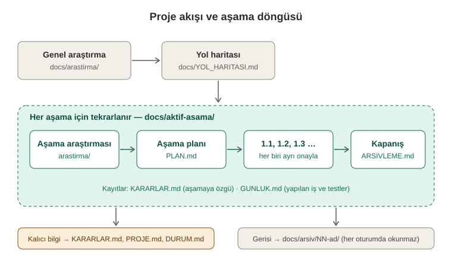

# AI proje şablonu (Codex + Claude)

Codex ve Claude ile VS Code'da proje geliştirirken aynı çalışma düzenini kullanmak için kurulan küçük bir kural ve belge paketi.

Hedefler:
- **Token tasarrufu:** her oturumda yalnız kısa kurallar, durum notu ve aktif aşamanın planı okunur.
- **Düzenli ilerleme:** genel plan → aşama planı → tek alt adım; her adım ayrı onayla.
- **Unutmama:** bütün bilgi repo dosyalarında; araç değişse de kaldığın yerden devam edilir.
- **Eski aşamaları okumama:** biten aşama arşive taşınır, kalıcı bilgisi ana belgelere aktarılır.



## Kurulum

Şablon paketinin kökünde Windows PowerShell ile:

```powershell
powershell.exe -NoProfile -File .\kur.ps1 -TargetDirectory "C:\Projeler\ProjeAdi"
```

Betik çalıştırma engellenirse yalnız bu işlem için:

```powershell
powershell.exe -NoProfile -ExecutionPolicy Bypass -File .\kur.ps1 -TargetDirectory "C:\Projeler\ProjeAdi"
```

Kurucu yalnız yeni dosya ekler. Kurulacak dosyalardan biri hedefte varsa hiçbir şey yazmadan durur. Ağ veya Git işlemi yapmaz; `.claude`, `.codex` ve diğer global klasörlere dokunmaz. Projendeki diğer dosyalar olduğu gibi kalır.

Ajana repo bağlantısını verip kurdurmak istersen şunu söyleyebilirsin:

> Bu şablon reposunu geçici bir klasöre indir, kur.ps1 ile şu anki projeme kur, kurulum sonucunu göster ve geçici klasörü yalnız benim onayımla sil.

## Kurulan dosyalar

```text
ProjeAdi/
├── AGENTS.md                 Kurallar (Codex okur; her oturumda yüklenir)
├── CLAUDE.md                 @AGENTS.md (Claude aynı kuralları okur)
├── .ai-sablon/kurulum.json   Kurulan sürüm ve dosya özetleri
└── docs/
    ├── DURUM.md              Şu an neredeyiz (oturum başında ilk okunan)
    ├── YOL_HARITASI.md       Ana aşamalar ve durumları
    ├── KARARLAR.md           Karar dizini (hepsi, tek satır) + proje geneli kararların tam metni
    ├── ACIK_KONULAR.md       Bekleyen kararlar, proje düzeyi sınırlar, devreden notlar
    ├── PROJE.md              Kodun güncel yapısı, komutlar, veri biçimleri
    ├── arastirma/            Genel araştırma belgelerin
    ├── aktif-asama/          Yalnız şu anki aşama
    │   ├── TASARIM.md        Aşama tasarımı, riskler, farklar (durum yazılmaz)
    │   ├── PLAN.md           Alt adımlar (1.1, 1.2 …) ve durumları
    │   ├── KARARLAR.md       Yalnız bu aşamayı ilgilendiren kararların tam metni
    │   ├── GUNLUK.md         Yapılan iş ve test sonuçları
    │   └── arastirma/        Bu aşamanın araştırma belgeleri
    ├── arsiv/                Biten aşamalar (her oturumda okunmaz)
    └── kurallar/             Yalnız gerektiğinde okunan ayrıntılar
        ├── ARSIVLEME.md      Aşama kapanış adımları
        ├── INCELEME.md       Riskli işlerde bağımsız inceleme
        └── sablonlar/        Yeni aşama için boş PLAN/TASARIM/KARARLAR/GUNLUK
```

## Kullanım

| Ne zaman | Ne yaparsın | Ajana örnek mesaj |
|---|---|---|
| Başlangıç | Genel araştırma belgelerini `docs/arastirma/` altına koy | "Araştırma belgelerini oku, yalnız yol haritasını hazırla." |
| Aşamaya başlarken | O aşamanın araştırma belgelerini `docs/aktif-asama/arastirma/` altına koy | "2. aşamayı başlat: araştırmayı oku, alt adımları planla, uygulama yapma." |
| Uygulama | Tek adım seç | "Yalnız 2.3'ü uygula." |
| Yeni kural | Çalışırken söyle | "Bundan sonra bütün tarihler UTC olsun, kurallara ekle." |
| Oturum sonu / araç değişimi | Durumu kaydettir | "DURUM.md'yi güncelle." |
| Yeni oturum | Durumu okut | "Durumu oku ve özetle, uygulamaya başlama." |
| Aşama bitince | Kapat | "2. aşamayı kapat ve arşivle." |

## Biten aşama nasıl ayrılır?

Aşama kapanırken ajan `docs/kurallar/ARSIVLEME.md` adımlarını uygular:

1. Bütün testleri çalıştırır, kapanış ölçütlerini kontrol eder.
2. Sonraki aşamaları etkileyen her şeyi ana belgelere taşır: kararların tam metnini `docs/KARARLAR.md`, kod/komut/veri biçimi bilgisini `docs/PROJE.md`, açık işleri `docs/ACIK_KONULAR.md` ve `docs/DURUM.md`. Emin olmadığını sana sorar.
3. Ana belgelerde birikmeyi temizler: yerine geçilmiş kararların tam metni arşive gider, dizinde tek satırı kalır (K-numarasına verilen bağlantılar kırılmaz).
4. Aşamaya kısa bir `OZET.md` yazar.
5. `docs/aktif-asama/` klasörünü bütünüyle `docs/arsiv/02-ad/` gibi bir klasöre taşır ve yerine boş bir aşama klasörü açar.
6. Yol haritasında aşamayı "Tamamlandı" yapar, arşiv bağlantısını ekler.

Sonuç: 3. aşamada çalışırken ajan 2. aşamanın günlüğünü ve kararlarını okumaz. Yalnız 2. aşamadan geriye kalan ve hâlâ geçerli olan bilgiyi (ana `KARARLAR.md` ve `PROJE.md`) görür.

## Kuralları değiştirmek

- **Tek projede kalıcı kural:** ajana söylemen yeterli; `AGENTS.md` dosyasının sonundaki "Projeye özel kurallar" bölümüne ekler.
- **Uzun, yalnız belirli işlerde gereken kural:** `docs/kurallar/proje-<konu>.md` dosyasına yazılır; `AGENTS.md` içinde tek satırlık işaretçi kalır.
- **Yalnız aktif aşamada geçerli kural:** aşamanın `PLAN.md` dosyasındaki "Aşama kuralları" bölümüne eklenir, aşamayla arşive gider.
- **Bütün projeler için:** bu repoda `genel/KURALLAR.md` düzenlenir. Kurulmuş projeler kendiliğinden güncellenmez.

## Bu repodaki dosyalar

| Dosya | Görev |
|---|---|
| `genel/KURALLAR.md` | Hedef projeye `AGENTS.md` olarak kurulan kurallar |
| `sablon/docs/` | Hedef projeye kurulan başlangıç belgeleri |
| `kur.ps1`, `surum.json` | Kurucu ve kurulacak dosya listesi |
| `gorseller/akis.svg` | Akış görseli |
| `docs/KURAL_ESLEME.md` | v0.1'deki kuralların v0.2'de nereye gittiği |
| `docs/arsiv/v0.1-gelistirme/` | Şablonun v0.1 geliştirme geçmişi |

Sürüm 0.2.0, durum "geliştirme". Doğrulama sonuçları ve açık sınırlar `docs/DURUM.md` içindedir.
